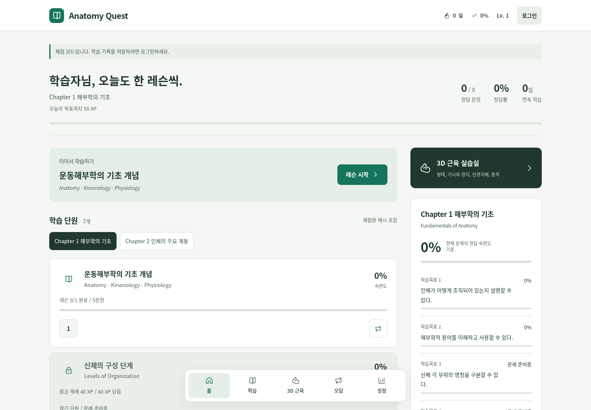
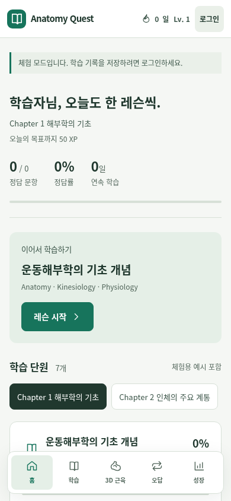
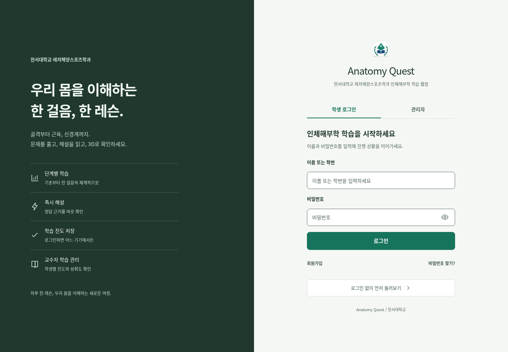

# Anatomy Quest UI/UX redesign

The student home previously placed chapter objectives and seven study-mode cards before the lesson list. The redesigned home puts the next lesson and curriculum first, with chapter mastery and 3D practice beside them on desktop. A single-column layout keeps the same content available on phones.

The visual system preserves the original green accent, replaces the later blue gradient with neutral green surfaces, increases small labels, and uses SVG icons for primary navigation and study controls. Login, quiz, professor, and atlas screens share the same tokens. Fonts use a Korean system stack so the app works without Google Fonts requests.

Quiz navigation follows the quiz instead of covering its answer button. Atlas tools have independent rows so larger touch targets do not overlap the isolate/opacity controls.

## Previews







## Validation

- `npm run build`: self-contained Worker, static assets, 3D bundle and migrations built successfully.
- `npm run test:ui`: checks registration, login/logout, a full five-question lesson, server grading, persisted progress after reload, professor student lookup, question-bank dialog, guest study, chapter selection, all student destinations, and seven study modes.
- Browser checks cover login and home at 320, 375, 390, 768, 1280, and 1920px without horizontal overflow. The atlas is also checked on a phone viewport.
- The actual GLB loads all 177 meshes. Search, selection, camera views, focus, isolate, reset, and teaching cards are exercised.
- No uncaught browser errors or failed network requests in the complete tested flow.
- Hallmark application-scope lint: zero FAIL and zero unresolved REFLEX findings. Existing fine-grained professor/atlas spacing is explicitly waived. Static warnings about old overridden declarations and repeated application-control recipes remain advisory; they do not establish a clean audit of every professor dialog or custom question state.

All account tests use the local SQLite database and locally simulated professor identity. Production accounts, student records, and the operational database are not used or migrated.

## Run browser verification

Install dependencies with `npm ci`, then build with `npm run build`. In a separate terminal start `LOCAL_PROFESSOR=1 npm run dev`. With Chrome/Chromium installed, run:

```sh
CHROME_PATH=/usr/bin/chromium npm run test:ui
```

The test requires this local professor simulation and creates disposable test students in `.local/anatomy.sqlite`. It must not target the operational service. Screenshots and the report go to `.local/ui-smoke/` and are ignored by Git.

## Scope

No API routes, authentication rules, grading rules, curriculum data, muscle geometry, or database schema were changed. The Worker build now includes the two shared CSS assets. Merging source changes does not deploy the existing Sites app automatically.

The login headline and supporting introduction were shortened, and home metadata was relabeled for readability. Existing forms, consent/disclaimer text, content sources, handler attributes, and navigation destinations remain. Decorative art and icons were simplified in the shared shell; instructor-authored emoji values remain in the curriculum editor.
